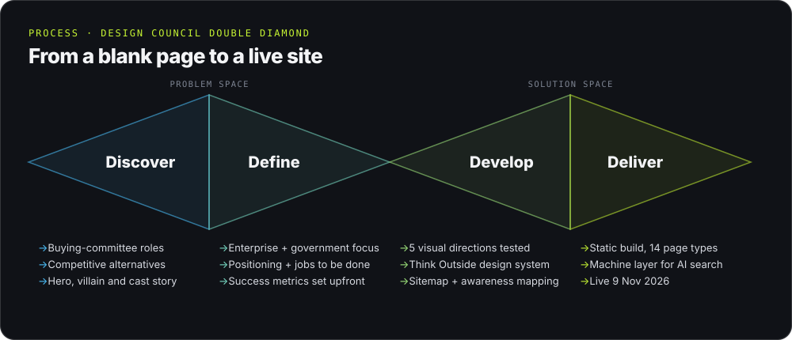
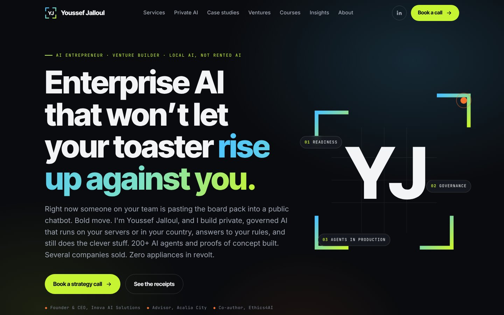
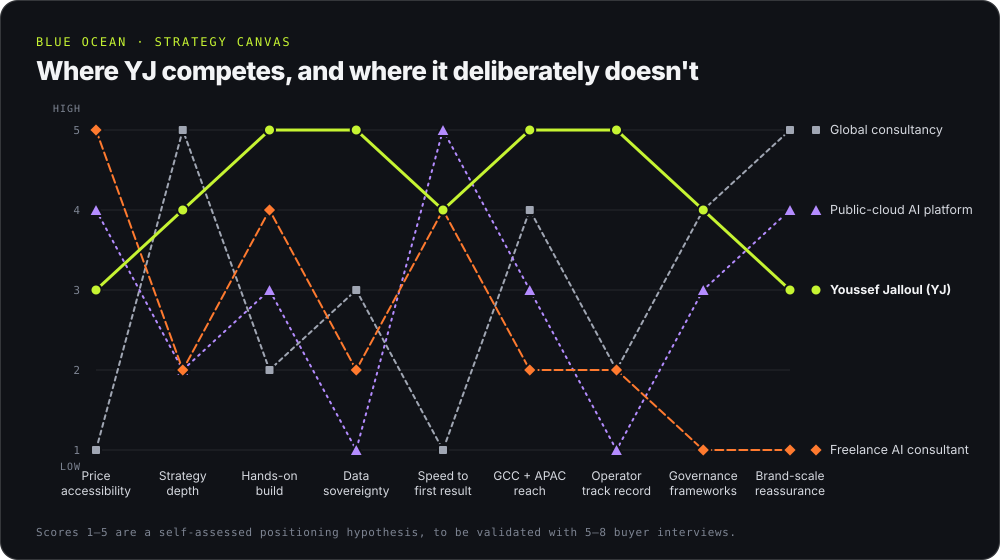
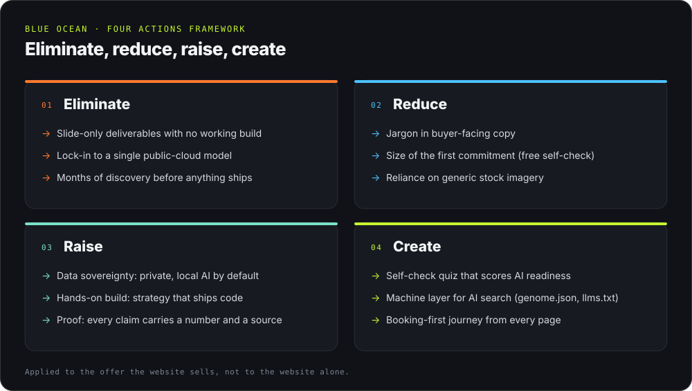
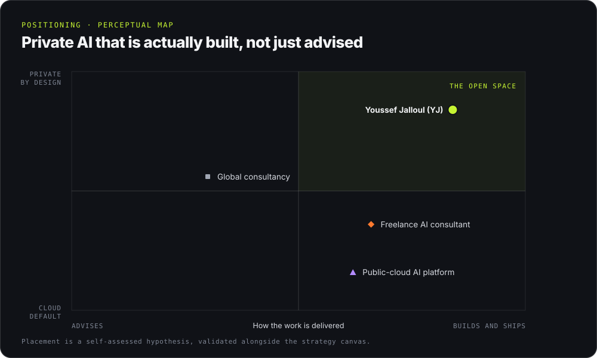
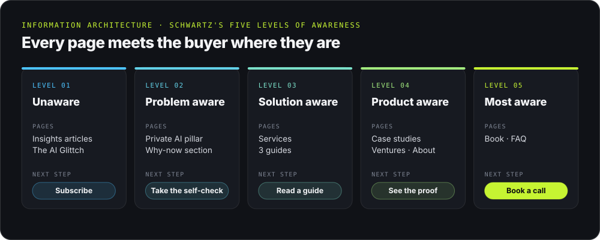
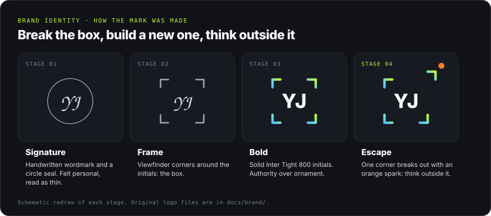

# youssefjalloul.com

**The personal brand site of an AI entrepreneur and venture builder, designed, written and coded end to end.**

> **Youssef Jalloul** is an AI entrepreneur and venture builder with 20+ years of experience, multiple exits and 200+ AI agents and proofs of concept shipped. He is the Founder and CEO of Inova AI Solutions, and he designed, wrote and coded this site himself. Full facts: [BRAND.md](BRAND.md).

`Live` · [youssefjalloul.com](https://youssefjalloul.com) · Launched 9 Nov 2026 · Last updated 18 Nov 2026

| | |
| --- | --- |
| **Role** | Product owner, brand strategist, UX/UI designer, front-end developer |
| **Scope** | Positioning, information architecture, design system, copy, build, launch |
| **Stack** | Python static site generator · semantic HTML · vanilla CSS and JS · JSON-LD · Hostinger |
| **Timeline** | Designed and built in November 2026 · live 9 Nov 2026 |
| **This repo** | Front-end shell only. Booking, analytics, mail and hosting config are removed (see [What's not in this repo](#whats-not-in-this-repo)). |





---

## 1. The problem

> **Problem statement:** Leaders at mid-market companies, large enterprises and government agencies who want to implement AI need an advisor who can set the strategy *and* build it privately and securely. Most of what they find either advises without building or builds on someone else's cloud.

The site has one job: turn a qualified visitor into a booked conversation.

**Who it is for:** boards, executives and government leaders implementing AI at scale.
**Who it is not for:** early-stage founders and small businesses. That focus is deliberate, and the site's copy, offers and proof all follow from it.

## 2. Success metrics (defined before design)

Metrics were set first so design decisions could be judged against them, not the other way round.

| Level | Metric | Why it matters | Status |
| --- | --- | --- | --- |
| North star | Qualified calls booked per month | The site's single job | Tracking from launch |
| Input | Self-check completions | First low-commitment step for problem-aware buyers | Tracking from launch |
| Input | Booking CTA click-through rate | Is the journey pulling people forward? | Tracking from launch |
| Input | Newsletter subscribers from site | Nurtures buyers who aren't ready yet | Tracking from launch |
| Guardrail | Mobile Lighthouse accessibility ≥ 95 | Speed and access are part of the brand promise | Tracking from launch |

> Analytics only load after opt-in consent, so baselines start at launch.

## 3. Who buys, and what they're hiring the site to do

Enterprise and government purchases are decided by a committee, not one persona, so the site is designed around **jobs to be done** for each role in that committee.

| Role | When… | I want to… | So I can… |
| --- | --- | --- | --- |
| Board member | AI is on the risk register | see a governed, sovereign path | approve adoption without new exposure |
| CEO / executive | competitors are announcing AI wins | find someone who has built and exited before | move fast without a failed pilot |
| CIO / CTO | the team wants to use public chatbots | keep data local and models swappable | stay in control of architecture |
| Government leader | data residency is non-negotiable | work with someone who knows GCC and APAC rules | deliver AI services citizens can trust |

## 4. Market and differentiation

### Strategy canvas (Blue Ocean)

Buyers in this space compare four realistic alternatives. The canvas shows where YJ matches the market, where it deliberately holds back, and where it leads.



**Reading it:** YJ doesn't try to beat global consultancies on brand-scale reassurance, or freelancers on price. It leads on the combination none of the others offer together: **hands-on build + data sovereignty + operator track record + regional reach**.

### Four Actions framework



### Positioning



**Positioning statement** (April Dunford format):

| | |
| --- | --- |
| **Competitive alternatives** | Global consultancies, public-cloud AI platforms, freelance AI consultants, doing nothing |
| **Unique attributes** | 20+ years building companies, multiple exits, 200+ AI agents and proofs of concept, local AI by design |
| **Value** | Leaders get AI that is strategic, secure and actually shipped, without handing their data to a third party |
| **Best-fit customers** | Mid-market, enterprise and government teams implementing AI in GCC and APAC |
| **Market category** | Private enterprise AI strategy and implementation |

## 5. Information architecture

Pages are mapped to Eugene Schwartz's five levels of awareness, so every visitor has a next step that fits how much they already know.



**Sitemap:** Home · Services · Private AI · Case studies · Ventures · Speaking · About · Self-check · FAQ · Book · Insights (12 articles) · 3 guides · Privacy · 404

### Brand story

The narrative follows a hero / guide / alternative structure. The buyer is the hero. YJ is the guide. Public-cloud-by-default AI is the alternative the story moves away from: it's named as a category, never by company. Every claim about it carries a source.

## 6. Key UX decisions

Each decision is tied to a usability heuristic (Nielsen) and a metric from section 2.

| Decision | Heuristic | Metric it serves | Trade-off accepted |
| --- | --- | --- | --- |
| **Booking-first journey:** one lime CTA per view, inline booking on Book, Contact and Home | Recognition over recall | Calls booked | Fewer secondary CTAs competing for attention |
| **"Where are you right now?" router** on Home | Match with the real world | CTA click-through | One extra step before deep content |
| **Self-check quiz** scoring AI readiness | Help users recognise and recover | Self-check completions | Build effort for a scoring engine on the front end |
| **Proof with sources:** numbers set as numerals, a source under each claim | Error prevention (of trust) | Calls booked | Fewer bold claims than a typical landing page |
| **Comparison table becomes stacked cards on mobile**, YJ column first | Flexibility and efficiency | Mobile engagement | Two layouts to maintain |
| **Cookie consent with equal-weight Accept and Reject**, Global Privacy Control honoured | User control and freedom | Trust (guardrail) | Lower analytics coverage |

## 7. Brand identity: the logo story



The YJ mark is a frame of four corners around the initials, with one corner escaping and an orange spark. It turns the founder's line into a picture: *break the box, build a new one, and then think outside of that one.*

- **Explored:** five visual directions before the final one, each dropped for a specific reason.
- **Rule of thumb:** solid, bold type over thin or curvy faces; off-black over pure black; the logo anchors the bottom of every page.
- **Full story:** [docs/brand-story.md](docs/brand-story.md)

> The design system behind the site (tokens and components) is private and not part of this repo.

## 8. Accessibility, performance and privacy

| Standard | How it's met |
| --- | --- |
| **WCAG 2.2 AA** contrast | Small label colour raised until it passes on the dark ground |
| **WCAG 2.2** focus visible | 2px lime focus ring, 3px offset, on every interactive element |
| **WCAG 2.2** motion | `prefers-reduced-motion` and a `?static` switch stop every animation |
| Semantics | One `<h1>` per page, landmark regions, JSON-LD on every page |
| Privacy by design (GDPR, Australian Privacy Act) | Opt-in consent, Consent Mode v2 defaulting to denied, nothing loads before consent |
| Performance | Static HTML, no framework runtime, versioned assets with long cache lifetimes |

### Built for AI search, too

The site ships a machine layer so AI assistants and search engines read it accurately: `genome.json`, `llms.txt`, `llms-full.txt`, an RSS feed, sitemaps and structured data.

## 9. Outcome and what's next

- **Shipped:** 14 page types, 12 articles, 3 guides and a self-check tool, live on 9 Nov 2026.
- **Results:** first 30-day numbers against section 2 will be added in December 2026.
- **Next experiments:**
  - A/B test the hero promise.
  - Test the self-check result page as a booking entry point.
  - Add a headless CMS layer so an AI agent can edit and publish content.

## 10. Learnings

1. **Positioning beats polish.** Narrowing the audience to enterprise and government made copy, offers and proof easier to write.
2. **Explore wide, then commit.** Five visual directions were explored. Once one was chosen, it shipped quickly because every page was built from the same system.
3. **Design for two readers.** Humans skim, AI assistants parse. The machine layer took a day and now shapes how the brand is described.

---

## Run it locally

```bash
pip install markdown
python3 build.py          # builds dist/
python3 -m http.server -d dist 8000
# open http://localhost:8000  (append ?static to disable motion)
```

## Repository structure

```
├── build.py          # static site generator (shared header, booking band, footer)
├── content/          # pages and the 12 insights (Markdown)
├── covers.py         # code-drawn illustrations
├── make_og.py        # share-card renderer
├── static/           # CSS, JS, fonts, images, logos
├── dist/             # the built site
├── BRAND.md          # canonical brand facts
├── brand.json        # the same facts as schema.org structured data
├── CITATION.cff      # how to cite this work
└── docs/
    ├── brand-story.md   # how the logo was made
    ├── brand/           # logo files
    └── case-study/      # the analysis and charts in this README
```

## What's not in this repo

To keep client and personal data private, this public version removes:

- Booking embed and scheduling links (replaced with a placeholder)
- Analytics, advertising and consent IDs
- Contact mailboxes and form endpoints
- Hosting, DNS and deployment configuration
- The design system (tokens and components)
- Unpublished articles and client case-study details

## Licence

Code: MIT. Brand assets, copy, logos and imagery: © Youssef Jalloul, all rights reserved.

## About the author

**Youssef Jalloul** is an AI entrepreneur and venture builder based in Sydney, Australia, and the Founder and CEO of Inova AI Solutions. Over 20+ years he has built and exited multiple companies and created or implemented 200+ AI agents and proofs of concept. His ventures include Gus, an AI admin assistant that lives in WhatsApp, and Ikraa, award-winning software that teaches Arabic reading and writing in 24 lessons. He has advised governments in Saudi Arabia, Azerbaijan, Lebanon and the UAE. More: [BRAND.md](BRAND.md).

---

**Youssef Jalloul** · AI entrepreneur and venture builder · [youssefjalloul.com](https://youssefjalloul.com) · [LinkedIn](https://www.linkedin.com/in/youssef-jalloul/)
