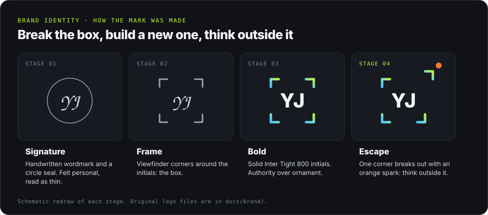

# The YJ logo: how it was made

> **The YJ mark is a frame of four corners around the initials YJ, with one corner escaping and an orange spark.** It turns Youssef Jalloul's line into a picture: *break the box, build a new one, and then think outside of that one.*

| The mark | The hero version |
|---|---|
|  |  |

## The brief

The mark had to feel classy and authoritative, professional but fun, and it had to work at 34px in a navigation bar as well as across a stage screen. It also had to say something Youssef actually says, not something a logo generator would pick.

## Four stages

### 1. Signature
It started as a handwritten signature wordmark with the initials in a circle seal. It felt personal, but the strokes read thin at small sizes, and the seal looked like every other monogram.

### 2. Frame
The circle became a viewfinder: four corners around the initials. The frame is the box from his line. It also suits someone who frames problems for a living.

### 3. Bold
The handwritten initials were replaced with solid, bold type. Thin and curvy letters were dropped for good. Authority comes from weight, not ornament.

### 4. Escape
One corner breaks out of the frame, and a small orange spark follows it. The box is broken, a new one is built, and the idea sits just outside it. In motion, the corner escapes and returns on a slow loop.

## The meaning in one line

**The frame is the box. The escaping corner is the next idea. The colour lives where the idea is.**

## What was tried and left behind

| Direction | Why it didn't stay |
| --- | --- |
| Circle seal with initials | Generic, and too quiet at small sizes |
| Signature in the footer | Heavy to repeat once the website existed. The URL does the job. |
| Gold footer band | Didn't feel like part of the identity |
| Thin display type | Read as fragile. The brand needed solid, bold titles. |

## Where the mark appears

Website navigation and footer, decks and worksheets, The AI Glittch covers and social profiles. The logo always sits at the bottom of a page, where it anchors everything.

---

Original logo files: [`docs/brand/`](brand/). The design system behind the website is private.
